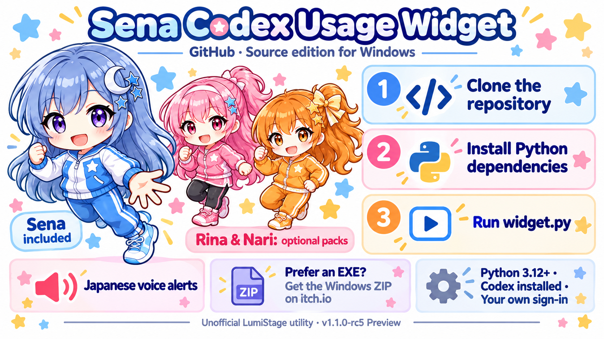

# Sena · Codex Usage Widget



A small, unofficial Windows desktop companion from LumiStage. See your own Codex
allowance without repeatedly opening the usage dashboard. Sena does not change,
extend or bypass your allowance. This is not an OpenAI product.

## Candidate status

Version **1.1.0-rc5** is a public preview / release candidate, not a stable release.
Code and asset terms were selected by the owner on 2026-10-26. Automated checks
do not replace human listening or a clean-PC/account test. Different-account,
real Plus 5-hour and itch desktop-app installation checks remain unverified.

## Choose your download

- **GitHub:** source code. Use this repository's **Code > HTTPS** address with
  `git clone`, enter the cloned folder, then follow the source commands below.
  Codex can help you review and set up the source; it does not remove the requirements.
- **itch.io:** ready-to-run Windows EXE ZIPs and optional Rina/Nari packs.
  Find the release on the [LumiStage creator page](https://animixing.itch.io/).
  Windows EXE downloads are not hosted in this GitHub repository.

For a source checkout, use Python 3.12+ in a dedicated environment:

```powershell
py -3 -m venv .venv
.\.venv\Scripts\python.exe -m pip install -r requirements.txt
.\.venv\Scripts\python.exe -B widget.py
```

Install Codex and sign in to your own account separately. For an account-free
preview, append `--preview --language en --details` to the last command.

## Start

- Easy portable build (`windows-x64-onefile.zip`): extract the ZIP and run
  `SenaUsageWidget.exe`. Sena's images, Japanese recordings and Python runtime
  are inside the EXE; external `assets` / `_internal` are not needed. Keep the
  accompanying documentation and license notices in the distributed ZIP.
- Folder portable build (`windows-x64.zip`): extract the **entire ZIP**, then run
  `SenaUsageWidget.exe`. This variant still needs `assets` and `_internal` beside it.
  The previous rc4 folder build is preserved. Python is bundled; Codex is not.
- Install Codex separately and sign into your **own** account on that PC. The widget
  has no shared developer login or bundled API key. A missing login is not a 0% balance.
- Source build: use Python 3.12+, `python -m pip install -r requirements.txt`, then
  `python -B widget.py`. `Start-Sena.cmd` also supports the Codex app's bundled Python
  when available. Dependencies and accounts can differ between PCs.
- New settings default to English with voice and motion on. Existing local installations keep
  their Korean UI and saved position/settings. Choose English, 한국어, 日本語 or 简体中文
  in the details window. **All optional voice recordings are Japanese**, regardless
  of the selected display language.
- Click Sena or the speech bubble for details; drag to move; right-click for a menu.
  Escape hides details. No Windows startup entry is created by this app.

The single EXE extracts its internal support files to a Windows temporary folder
while running and may start more slowly. It is not an installer or a promise of
zero disk writes. Both variants share the same existing user-settings location.
Close the running normal widget before using the other normal variant; previews
can be tested separately. See `INSTALL_KO.md` for Korean instructions.

## Quotas and states

Compact display options: **Auto**, **5-hour**, **Weekly**, or **Both limits**. Auto
shows the smallest remaining percentage. The server's actual window duration is
used, not a guessed allowance based solely on the plan name. If a selected window
is not returned, the app displays “Not provided”, not 100% or unlimited.

- 100%: fully restored state. The recovery recording is triggered only after an
  observed lower allowance returns to 100% across all reported windows, not on startup.
- 20% or less: low state, with a one-time threshold-crossing notification.
- 0%: exhausted included allowance, not proof that credit-funded usage is impossible.
- Failed/stale/missing information: unverified state, never an invented 0%.

Repeated reads of the same state do not replay speech. Startup, account/plan/window
changes, observation gaps and connection failures do not generate a recovery sound.
The original Sena training-outfit artwork and pose priority are restored. Rina and
Nari use their matching original training-outfit art with the same rules and timing:
normal verified usage cycles the original three frames every 750 ms; low/empty
show the original fail reaction, and observed recovery shows the original success
reaction for 15 seconds before resuming normal motion. Low/empty share that reaction,
as in the basic edition. Unverified information uses idle artwork. No artificial
up/down movement, costume swaps or character-specific timing are added. A 100%
reading alone no longer freezes the character in a permanent recovery pose.

Visual design, costumes, artwork and animation changes require the owner's prior
approval. A functional bug fix is not authorization to redesign the characters.

## Optional audio and packs

Automatic voice is **on by default**, with a per-widget 0–100 volume control. No
startup speech is generated. Saved explicit off preferences remain off. It plays short,
pre-recorded 16-bit PCM WAV files; there is no cloud TTS, AI generation or extra
model request. Missing/invalid audio stays silent and does not stop quota display.
See `VOICE_BRIEF_JA.md`. Voice-file presence is not a rights or listening-quality approval.

The basic edition is complete with Sena alone. Separate Rina and Nari local packs replace
images, optional animation and Japanese voice files. No general plugin engine or
automatic download/update system is provided. See `PACK_FORMAT.md`.
With either packaging variant, optional packs remain under `packs/<id>/` beside
the EXE. The single-EXE base edition embeds Sena only, not optional characters.

## Privacy, safety, and limitations

Read `PRIVACY.md`. The local Codex process contacts OpenAI using that PC's normal
authentication. We do not describe the utility as entirely offline. It does not
upload usage to a developer server, run model turns, buy credits, auto-reset limits,
or inspect conversations. Do not send auth.json, tokens, runtime history or private
screenshots to the issue tracker. Preview mode uses sample data:

`python -B widget.py --preview --language en --details`

The preview details include a state selector for recording demonstrations without
changing actual quotas. Never label preview values as real account measurements.
In a Windows portable folder, double-click `Preview-Sena.cmd` for this synthetic,
account-free preview. This does not require restarting your normal widget.
Select a character, choose the recovery/low/empty recording and press Test voice.
The test button works even when automatic voice alerts are off; volume zero remains
silent with an explanation. Preview starts with voice/motion on without saving that
override. In preview a test also selects the matching sample state. Stop voice,
mute, volume zero, character change and exit cancel this widget's audio. Additional
requests while playing are skipped, not queued. Audio uses a private Windows output
handle and does not adjust system volume or write temporary audio files.

The app relies on Codex's app-server protocol, which may change. It requires a
compatible Codex installation and an account response containing quotas. Server
delays and rounding are not corrected by this widget. Account-free previews and
automated tests are not a substitute for a clean-PC/account test. Japanese and
Chinese translations should receive native-speaker review before broad release.

Windows executables are unsigned at this candidate stage. Do not disable antivirus,
SmartScreen or other security controls to run them. Verify the source/download and
SHA-256 checksum; investigate any warning before proceeding. No administrator
privileges should be required. macOS/Linux builds are not supplied or claimed tested.

## Source, builds, and releases

Tests: `python -B -m unittest test_widget test_screens test_features test_release test_voices test_bundle -q`.
Build dependencies: `python -m pip install -r requirements-build.txt`.
Build a **new output directory** with:

`python -B make_release.py --output ./outputs/candidate-1 --windows --onefile`

The packager uses an explicit source-file allowlist. It excludes runtime data,
credentials, old previews, private QA reports and backups. It creates source and
Windows ZIPs plus `SHA256SUMS.txt` and `CANDIDATE_STATUS.json`. Rebuilding requires
new archive checksums; do not overwrite a published version's files.

GitHub distributes source; itch.io distributes Windows EXE ZIPs and character
packs. GitHub's automatic “Source code” archive is not an executable package.
Check each file against its own published SHA-256 checksum. Public package
documentation was updated after the internal rc5 handoff; the runtime binaries
and character media are unchanged, but the ZIP checksums are therefore new.

An explicit `--bundle-check report.json` diagnostic verifies local assets without
opening a window or reading an account/settings. Adding `--check-audio` tests the
recordings at volume 10. This is a packaging diagnostic, not listening approval or
an end-to-end GUI/clean-PC test; reports contain hashes rather than account values.

## Licensing and credits

Application code is MIT-licensed under `LICENSE-CODE.md`. Character images,
promotional artwork and recorded voices are NOT MIT-licensed; see
`LICENSE-ASSETS.md`. They are permitted for use in this widget and its character
packs, not for separate extraction/reuse, resale, or model training.
Third-party components retain their own licenses. Voice provenance and remaining
verification limits are documented in `VOICE_CREDITS.md`. No model weights or
reference recordings are bundled.

Primary references: [Codex app-server](https://learn.chatgpt.com/docs/app-server),
[Codex authentication](https://learn.chatgpt.com/docs/auth),
[GitHub Releases](https://docs.github.com/en/repositories/releasing-projects-on-github/managing-releases-in-a-repository).
